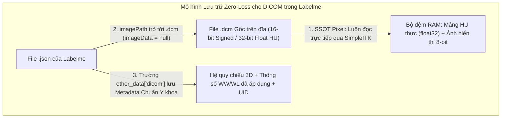
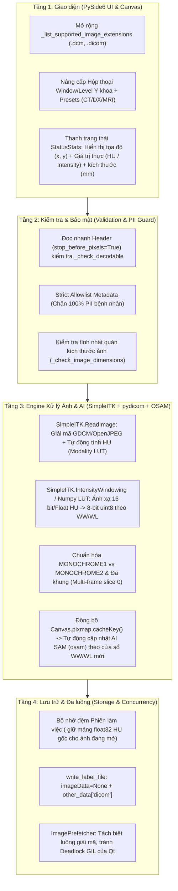

# Kế hoạch Kiến trúc (`plan_labelme_dicom_slicer.md`): Tích hợp DICOM Chuẩn 3D Slicer vào Desktop App `Labelme`

> [!IMPORTANT]
> Tài liệu này thiết kế kiến trúc mức cao và định vị 4 tầng để nâng cấp nhánh Desktop App \[`labelme`\](file:///home/apollai/Documents/GitHub/medical/labelme) hỗ trợ đọc, hiển thị tương tác Window Width / Window Level (WW/WL) chuẩn **3D Slicer** (`SimpleITK` + `pydicom`) và lưu trữ nhãn với độ chính xác y khoa tối đa. Tài liệu tuân thủ quy tắc không viết mã code chi tiết.

______________________________________________________________________

## 1. Lời giải Kiến trúc cho Câu hỏi số 4: Làm sao đạt Độ chính xác Dữ liệu Y tế Cao nhất trong file `.json` của `Labelme`?

### Phản biện Kỹ thuật (Devil's Advocate) về cơ chế lưu `.json` mặc định của `Labelme`

Trong thiết kế nguyên bản của `Labelme` (\[`_label_file.py`\](file:///home/apollai/Documents/GitHub/medical/labelme/labelme/\_label_file.py#L339-L386) và \[`read_label_file`\](file:///home/apollai/Documents/GitHub/medical/labelme/labelme/\_label_file.py#L431-L488)):

1. **Rủi ro mất mát dải động 16-bit/Hounsfield Unit (HU) nếu nhúng `"imageData"`**:
   - Nếu bật `with_image_data: true`, `Labelme` sẽ mã hóa ảnh đã qua biến đổi thành chuỗi base64 (`JPEG` 8-bit nén suy hao hoặc `PNG` 16-bit không dấu) và ghi vào trường `"imageData"` trong file `.json`.
   - Khi mở lại file `.json`, hàm \[`read_label_file`\](file:///home/apollai/Documents/GitHub/medical/labelme/labelme/\_label_file.py#L444-L453) kiểm tra `if raw["imageData"] is None:`. Nếu `"imageData"` có dữ liệu, `Labelme` **bỏ qua hoàn toàn file `.dcm` gốc trên ổ cứng** và chỉ giải mã bức ảnh 8-bit trong `"imageData"`.
   - **Hậu quả y khoa**: Giả sử Bác sĩ A mở ảnh CT ngực, chọn cửa sổ Phổi (`WC = -600, WW = 1500`) để vẽ tổn thương phổi rồi lưu `.json`. Khi Bác sĩ B mở lại file `.json` đó để kiểm tra trung thất hoặc xương sườn (`WC = 400, WW = 1800`), toàn bộ tín hiệu HU của xương và mô mềm ngoài cửa sổ phổi đã bị cắt cụt vĩnh viễn thành màu trắng/đen thuần túy trong `"imageData"`.
2. **Rủi ro mất hệ quy chiếu không gian 3D (Spatial Geometry) và Calibration**:
   - File `.json` mặc định của `Labelme` chỉ lưu tọa độ điểm `[x, y]` theo đơn vị pixel (`float64`) cùng `imageWidth` và `imageHeight`.
   - Trong y khoa, tọa độ pixel `[x, y]` là vô nghĩa nếu thiếu kích thước vật lý của pixel (`PixelSpacing` tính bằng `mm`), độ dày lát cắt (`SliceThickness`), và ma trận định hướng không gian 3D của bệnh nhân (`ImagePositionPatient`, `ImageOrientationPatient` theo hệ trục LPS/RAS của **3D Slicer**).

### Kiến trúc Lưu trữ "Zero-Loss Medical Fidelity" (Độ chính xác Y khoa 100%)

Để đạt độ chính xác cao nhất, chúng ta áp dụng **Mô hình 3 Trụ cột** tận dụng cơ chế `other_data` có sẵn của \[`Annotation`\](file:///home/apollai/Documents/GitHub/medical/labelme/labelme/\_label_file.py#L305-L310):

1. **Trụ cột 1 — File `.dcm` gốc là Nguồn Sự thật Duy nhất (SSOT) cho dữ liệu Pixel**:
   - Với file nguồn là DICOM (`.dcm` / `.dicom`), luôn giữ `imageData = null` trong file `.json` (trừ khi file `.dcm` gốc không tồn tại trên đĩa).
   - Ngay cả khi người dùng mở một file `.json` cũ có chứa `"imageData"`, nếu đường dẫn `imagePath` trỏ tới file `.dcm` hợp lệ trên đĩa, hệ thống **bắt buộc ưu tiên đọc lại mảng tín hiệu gốc từ file `.dcm` bằng `SimpleITK`** để khôi phục 100% dải Hounsfield Unit (HU).
2. **Trụ cột 2 — Bổ sung khối Metadata Y khoa `"dicom"` vào `other_data` của file `.json`**:
   - Hàm \[`read_label_file`\](file:///home/apollai/Documents/GitHub/medical/labelme/labelme/\_label_file.py#L481) và \[`write_label_file`\](file:///home/apollai/Documents/GitHub/medical/labelme/labelme/\_label_file.py#L520-L523) của `Labelme` cho phép lưu mọi khóa mở rộng thông qua `annotation.other_data`. Chúng ta định nghĩa cấu trúc `other_data["dicom"]` lưu chính xác 3 nhóm thông số:
     - **Nhóm Định danh & Liên kết 3D PACS/Slicer (`uids`)**: `SOPInstanceUID` `(0008,0018)`, `SeriesInstanceUID` `(0020,000E)`, `StudyInstanceUID` `(0020,000D)`, `FrameOfReferenceUID` `(0020,0052)`, `InstanceNumber` `(0020,0013)`. Nhờ các UID chuẩn này, dù file `.dcm` có bị đổi tên, nhãn vẽ từ `Labelme` vẫn ghép khớp 100% vào đúng lát cắt trong khối 3D trên **3D Slicer**.
     - **Nhóm Hình học Không gian Vật lý (`geometry`)**:
       - `pixelSpacingMm`: `[row_spacing_mm, col_spacing_mm]` (từ `PixelSpacing` `(0028,0030)` hoặc `ImagerPixelSpacing` `(0018,1164)`).
       - `sliceThicknessMm` `(0018,0050)` và `spacingBetweenSlicesMm` `(0018,0088)`.
       - `imagePositionPatient` `(0020,0032)`: `[origin_x, origin_y, origin_z]` (tọa độ thực tính bằng `mm` của điểm ảnh đầu tiên `(0,0)` trong không gian bệnh nhân).
       - `imageOrientationPatient` `(0020,0037)`: 6 cô-sin chỉ hướng `[row_x, row_y, row_z, col_x, col_y, col_z]` (hoặc ma trận hướng 3x3 lấy trực tiếp từ `SimpleITK.Image.GetDirection()`). Với bộ 3 thông số (`pixelSpacingMm`, `imagePositionPatient`, `imageOrientationPatient`), mọi điểm `[x, y]` (`float64`) vẽ trong `Labelme` đều có thể chuyển đổi toán học chính xác tuyệt đối sang tọa độ 3D `(X_mm, Y_mm, Z_mm)` của **3D Slicer** mà không bị lệch dù chỉ `0.01 mm`!
     - **Nhóm Tín hiệu & Trạng thái Hiển thị Lâm sàng (`radiometry` & `viewState`)**:
       - `modality` `(0008,0060)`, `photometricInterpretation` `(0028,0004)`, `bitsStored` `(0028,0101)`.
       - `rescaleSlope` `(0028,1053)`, `rescaleIntercept` `(0028,1052)`, `rescaleType` `(0028,1054)` (ví dụ `"HU"`).
       - `headerWindowCenter` & `headerWindowWidth` (giá trị gốc trong file DICOM).
       - `appliedWindowCenter`, `appliedWindowWidth`, `appliedPresetName`, `isInverted` (trạng thái cửa sổ WW/WL chính xác mà bác sĩ đang bật lúc lưu nhãn). Khi bác sĩ khác mở lại file `.json` này, `Labelme` tự động khôi phục đúng cửa sổ WW/WL đó trên màn hình.
3. **Trụ cột 3 — Chốt chặn Bảo mật Thông tin Bệnh nhân (PII / HIPAA Sanitization)**:
   - Bộ trích xuất metadata từ `pydicom` sử dụng cơ chế **Allowlist nghiêm ngặt (Strict Allowlist)**: chỉ lấy các tag kỹ thuật và hình học nêu trên; tuyệt đối loại bỏ `PatientName`, `PatientID`, `PatientBirthDate`, `PatientSex`, `PatientAddress`, `InstitutionName`, `ReferringPhysicianName`, `AccessionNumber` khỏi file `.json`.

______________________________________________________________________

## 2. Thiết kế Kiến trúc Xuyên 4 Tầng trong `Labelme`

### Tầng 1: Giao diện Người dùng (`UI / PySide6 Widgets & Canvas`)

1. **Nhận diện và duyệt file DICOM (\[`labelme/_app.py`\](file:///home/apollai/Documents/GitHub/medical/labelme/labelme/\_app.py#L5040-L5086))**:
   - Cập nhật hàm \[`_list_supported_image_extensions`\](file:///home/apollai/Documents/GitHub/medical/labelme/labelme/\_app.py#L5040-L5047) để luôn bao gồm `.dcm` và `.dicom`. Nhờ vậy, hộp thoại `Open File`, `Open Folder`, tính năng kéo-thả (`dragEnterEvent`/`dropEvent`) và thanh tìm kiếm danh sách file hoạt động xuyên suốt với file DICOM.
2. **Hộp thoại Chuyên sâu Window Width / Window Level (WW/WL) & Presets (\[`labelme/_widgets/_brightness_contrast_dialog.py`\](file:///home/apollai/Documents/GitHub/medical/labelme/labelme/\_widgets/\_brightness_contrast_dialog.py))**:
   - Khi ảnh đang mở là ảnh thường (`.png`, `.jpg`, `.tif`), hộp thoại giữ nguyên chế độ chỉnh **Brightness / Contrast** truyền thống để không phá vỡ tính tương thích ngược (Backward Compatibility) và các bài test hiện hữu của `Labelme`.
   - Khi ảnh đang mở là **DICOM**, hộp thoại (hoặc chế độ DICOM trong hộp thoại) chuyển sang **Chế độ Cửa sổ Y khoa (Medical Window/Level - chuẩn 3D Slicer)** thao tác trực tiếp trên **mảng dữ liệu HU/Intensity gốc (`float32`)**:
     - **Thanh trượt & Ô nhập số chính xác**: `Window Center (WL)` và `Window Width (WW)` với dải giá trị tự động co giãn theo `min/max` thực tế của mảng pixel (ví dụ từ `-1024` đến `+3071` HU đối với CT).
     - **Danh sách Clinical Presets (Chọn nhanh 1 chạm như 3D Slicer)**:
       - *Auto (DICOM Header / 2nd–98th Percentile)*
       - *CT Brain* (`WL: 40, WW: 80`)
       - *CT Lung* (`WL: -600, WW: 1500`)
       - *CT Mediastinum / Soft Tissue* (`WL: 40, WW: 400`)
       - *CT Abdomen / Liver* (`WL: 60, WW: 160`)
       - *CT Bone* (`WL: 400, WW: 1800`)
       - *CT Stroke* (`WL: 32, WW: 8`)
     - **Nút Đảo ngược Sáng/Tối (`Invert Monochrome`)**: Cho phép bác sĩ chủ động lật âm bản/dương bản tức thì.
     - **Hỗ trợ "Keep Previous Brightness/Contrast (Window/Level)"**: Khi bật tùy chọn \[`keep_prev_brightness_contrast`\](file:///home/apollai/Documents/GitHub/medical/labelme/labelme/\_app.py#L201), nếu bác sĩ chuyển từ lát cắt CT số 1 sang lát cắt CT số 2 trong cùng thư mục, cửa sổ WW/WL đang chọn (ví dụ *CT Lung*) được giữ nguyên xuyên suốt chuỗi ảnh!
3. **Data Probe trên Thanh Trạng thái (\[`labelme/_widgets/_status.py`\](file:///home/apollai/Documents/GitHub/medical/labelme/labelme/\_widgets/\_status.py))**:
   - Học tập tính năng **Data Probe** nổi tiếng của **3D Slicer**: Khi di chuột trên Canvas của ảnh DICOM, \[`StatusStats.set_position`\](file:///home/apollai/Documents/GitHub/medical/labelme/labelme/\_widgets/\_status.py#L24-L25) và \[`MainWindow._update_status_stats`\](file:///home/apollai/Documents/GitHub/medical/labelme/labelme/\_app.py#L4855-L4856) không chỉ hiển thị tọa độ `x, y` mà còn hiển thị thêm **giá trị tín hiệu thực tại điểm trỏ chuột** (ví dụ: `x  256   y  312   HU: -642` đối với CT hoặc `Val: 1840` đối với X-quang/MRI) cùng đơn vị `Modality`.

### Tầng 2: Kiểm tra Dữ liệu & Bảo mật (`Validation & Security Guard`)

1. **Kiểm tra giới hạn bộ nhớ trước khi giải mã Pixel (\[`labelme/_label_file.py`\](file:///home/apollai/Documents/GitHub/medical/labelme/labelme/\_label_file.py#L587-L607))**:
   - Trước khi nạp toàn bộ mảng pixel của file DICOM, dùng `pydicom.dcmread(filename, stop_before_pixels=True, force=True)` hoặc `SimpleITK.ImageFileReader.ReadImageInformation()` để lấy nhanh `Rows` (chiều cao) và `Columns` (chiều rộng) và gọi \[`_check_decodable`\](file:///home/apollai/Documents/GitHub/medical/labelme/labelme/\_label_file.py#L587-L607). Nếu ảnh vượt quá `RASTER_MAX_SIDE` (`32767`) hoặc `max_decode_mb`, hệ thống cảnh báo an toàn giống hệt ảnh TIFF/PNG khổng lồ.
2. **Chuẩn hóa hình học khi đọc ảnh DICOM bị chữ nhật lệch tỷ lệ (`Non-Square Pixel Spacing`)**:
   - Một số ảnh MRI hoặc siêu âm cũ có `PixelSpacing` theo chiều dọc và chiều ngang không bằng nhau (`row_spacing != col_spacing`). Metadata `pixelSpacingMm` sẽ ghi nhận chính xác cả 2 chiều `[row_mm, col_mm]` để đảm bảo tính diện tích/khoảng cách vật lý không bị sai số.
3. **Bộ lọc PII (Strict Allowlist)**:
   - Đảm bảo trong module mới `labelme/_dicom.py`, hàm trích xuất metadata chỉ đọc danh sách các tag kỹ thuật được phép, cam kết không bao giờ lộ thông tin cá nhân của bệnh nhân vào file `.json` hay log.

### Tầng 3: Engine Giải mã & Xử lý Ảnh Y khoa (`SimpleITK` + `pydicom`)

1. **Module chuyên biệt `labelme/_dicom.py`**:
   - Đóng gói toàn bộ logic đọc và xử lý DICOM tách biệt, giữ cho \[`_label_file.py`\](file:///home/apollai/Documents/GitHub/medical/labelme/labelme/\_label_file.py) sạch sẽ và dễ bảo trì.
   - **Bước 1 — Đọc Metadata bằng `pydicom`**: Gọi `pydicom.dcmread(..., stop_before_pixels=True, force=True)` để lấy `WindowCenter`, `WindowWidth`, `PhotometricInterpretation`, `Modality`, `RescaleSlope`, `RescaleIntercept`, `PixelSpacing`, `ImagePositionPatient`, `ImageOrientationPatient`, và các `UID`.
   - **Bước 2 — Giải mã Pixel & Modality LUT bằng `SimpleITK`**:
     - Sử dụng `SimpleITK.ReadImage` (bên dưới là C++ ITK + GDCM + OpenJPEG giống **3D Slicer**) để giải mã mọi định dạng DICOM (kể cả JPEG Lossless, JPEG 2000, RLE) và tự động tính toán giá trị vật lý (Hounsfield Units).
     - Trong trường hợp file DICOM bị lỗi cấu trúc thư mục hoặc thiếu preamble chuẩn khiến `SimpleITK` từ chối nhưng `pydicom(force=True)` đọc được, hệ thống có nhánh fallback sang `pydicom.pixels.apply_modality_lut`.
     - Nếu mảng trả về là 3D/Multi-frame `(Frames, H, W)` (ví dụ 1 lát cắt DICOM được lưu dưới dạng `(1, H, W)` của `SimpleITK` hoặc chuỗi cine siêu âm), tự động trích xuất frame 2D tương ứng `(H, W)` để tương thích với `Canvas` 2D của `Labelme`.
   - **Bước 3 — Áp dụng Cửa sổ Tín hiệu (VOI LUT / Windowing) & Photometric Interpretation**:
     - Ánh xạ mảng `float32` HU sang `uint8` (`0..255`) theo công thức chuẩn DICOM Phần 3 (PS3.3 C.11.2.1.2) hoặc dùng `SimpleITK.IntensityWindowing`.
     - Nếu file không có `WindowCenter`/`WindowWidth` trong header (thường gặp ở một số máy X-quang CR/DX), tự động tính cửa sổ thông minh theo phân vị `1st–99th percentile` (loại bỏ vùng viền đen chữ chì collimator của X-quang).
     - **Quy tắc Đảo màu chuẩn Y khoa**: Chỉ đảo ngược mảng `255 - pixel` khi `PhotometricInterpretation == "MONOCHROME1"` (hoặc khi người dùng bật cờ `isInverted`), tuyệt đối không đảo ngược mù quáng theo tên `Modality`.
2. **Tương thích hoàn hảo với AI Segmentation (`osam` / SAM2 / SAM3)**:
   - Khi bác sĩ đổi cửa sổ WW/WL (ví dụ chuyển sang *CT Bone* hoặc *CT Lung*), hộp thoại WW/WL phát tín hiệu cập nhật `QImage` $\\rightarrow$ `Canvas.load_pixmap(clear_shapes=False)`.
   - Vì \[`_refresh_ai_segment_preview`\](file:///home/apollai/Documents/GitHub/medical/labelme/labelme/\_widgets/\_canvas.py#L2857-L2863) trong `Canvas` sử dụng `self.pixmap.cacheKey()` làm khóa nhận diện ảnh, ngay khi bác sĩ chỉnh WW/WL để làm rõ khối u rồi bấm công cụ **AI-Segment**, mô hình SAM sẽ tự động phân vùng dựa trên đúng độ tương phản cửa sổ y khoa mà bác sĩ đang nhìn thấy!

### Tầng 4: Lưu trữ, Bộ nhớ Đệm & Xử lý Đa luồng (`Storage & Concurrency`)

1. **Giữ Bộ đệm Mảng 16-bit/Float HU cho Phiên Làm việc Hiện tại**:
   - Trong `MainWindow`, khi mở một file DICOM, mảng dữ liệu gốc `float32` (đã qua Modality LUT) và thông tin `DicomMetadata` của ảnh đang mở được lưu giữ trên RAM.
   - Nhờ đó, khi bác sĩ kéo thanh trượt `Window Center` / `Window Width` hoặc rê chuột xem `HU` trên thanh trạng thái, việc tính toán lại ảnh hiển thị 8-bit diễn ra tức thời (< 5ms cho ảnh 512x512) trên mảng `float32` gốc mà không cần đọc lại ổ cứng và không bị suy giảm chất lượng.
2. **Cập nhật Luồng Đọc/Ghi \[`_label_file.py`\](file:///home/apollai/Documents/GitHub/medical/labelme/labelme/\_label_file.py) & \[`_app.py`\](file:///home/apollai/Documents/GitHub/medical/labelme/labelme/\_app.py)**:
   - Tại \[`_capture_save_request`\](file:///home/apollai/Documents/GitHub/medical/labelme/labelme/\_app.py#L2726-L2758): Khi lưu file `.json` cho ảnh DICOM, tự động gắn khối `"dicom"` (chứa `uids`, `geometry`, `radiometry`, `viewState` hiện tại) vào `annotation.other_data["dicom"]`.
   - Khi mở lại một file `.json` của ảnh DICOM trong \[`_load_file`\](file:///home/apollai/Documents/GitHub/medical/labelme/labelme/\_app.py#L3438-L3674): Đọc thông số `viewState` (`appliedWindowCenter`, `appliedWindowWidth`, `isInverted`) từ `annotation.other_data.get("dicom")` để tái tạo lại đúng góc nhìn y khoa mà bác sĩ đã lưu.
3. **An toàn Đa luồng với \[`ImagePrefetcher`\](file:///home/apollai/Documents/GitHub/medical/labelme/labelme/\_image_prefetcher.py#L23-L60)**:
   - Giữ nguyên chốt chặn an toàn tại hàm \[`_decode`\](file:///home/apollai/Documents/GitHub/medical/labelme/labelme/\_image_prefetcher.py#L29) của `ImagePrefetcher` (không dùng `QImageReader` trên background thread cho `.dcm`), đảm bảo không bao giờ xảy ra hiện tượng deadlock GIL với PySide6 GUI thread.

______________________________________________________________________

## 3. Danh mục File Dự kiến Tác động trong Nhánh `labelme`

| Tầng | File trong `/home/apollai/Documents/GitHub/medical/labelme` | Vai trò thay đổi |
| :--- | :--- | :--- |
| **Cấu hình gói** | \[`pyproject.toml`\](file:///home/apollai/Documents/GitHub/medical/labelme/pyproject.toml) | Bổ sung phụ thuộc `SimpleITK>=2.3.0` và `pydicom>=2.4.0`. |
| **Tầng Engine & Bảo mật (L2 & L3)** | `labelme/_dicom.py` *(File mới)* | Chứa bộ đọc kết hợp `SimpleITK` + `pydicom`, trích xuất metadata an toàn (Strict Allowlist chống lộ PII), tính toán Modality LUT (HU), VOI LUT (WW/WL), danh sách Clinical Presets, và xử lý `MONOCHROME1`/`MONOCHROME2`. |
| **Tầng Đọc/Ghi File (L2 & L4)** | \[`labelme/_label_file.py`\](file:///home/apollai/Documents/GitHub/medical/labelme/labelme/\_label_file.py) | Mở rộng \[`_imread`\](file:///home/apollai/Documents/GitHub/medical/labelme/labelme/\_label_file.py#L609-L636) để nhận diện và giải mã `.dcm`/`.dicom` qua `_dicom.py`; ưu tiên đọc từ file `.dcm` gốc khi mở `.json`. |
| **Tầng Giao diện WW/WL (L1)** | \[`labelme/_widgets/_brightness_contrast_dialog.py`\](file:///home/apollai/Documents/GitHub/medical/labelme/labelme/\_widgets/\_brightness_contrast_dialog.py) | Bổ sung chế độ điều chỉnh **Window Center (WL) / Window Width (WW)** + **Clinical Presets** + **Invert** trực tiếp trên mảng `float32` HU cho ảnh DICOM (giữ nguyên chế độ Brightness/Contrast cũ cho ảnh thường). |
| **Tầng Thanh trạng thái (L1)** | \[`labelme/_widgets/_status.py`\](file:///home/apollai/Documents/GitHub/medical/labelme/labelme/\_widgets/\_status.py) | Mở rộng \[`StatusStats`\](file:///home/apollai/Documents/GitHub/medical/labelme/labelme/\_widgets/\_status.py#L11-L25) để hiển thị thêm giá trị tín hiệu thực (`HU` / `Intensity`) tại vị trí con trỏ chuột giống Data Probe của **3D Slicer**. |
| **Tầng Điều phối App (L1 & L4)** | \[`labelme/_app.py`\](file:///home/apollai/Documents/GitHub/medical/labelme/labelme/\_app.py) | Cập nhật \[`_list_supported_image_extensions`\](file:///home/apollai/Documents/GitHub/medical/labelme/labelme/\_app.py#L5040-L5047), quản lý trạng thái WW/WL theo từng ảnh (và `keep_prev`), truyền giá trị HU vào `StatusStats`, và lưu/khôi phục `other_data["dicom"]` khi đóng/mở file `.json`. |
| **Kiểm thử Tự động (QA)** | `tests/unit/test_dicom.py` *(File mới)* | Kiểm thử hộp xám toàn diện: giải mã `SimpleITK`, chuẩn hóa HU, đảo màu `MONOCHROME1` vs `MONOCHROME2`, lọc PII, tương tác WW/WL, và bảo toàn metadata trong `.json`. |

______________________________________________________________________

## 4. Các Quyết định Kiến trúc Đã Chốt (Confirmed Decisions)

1. **Mục tiêu tích hợp**: Chỉ bổ sung trực tiếp khả năng đọc & đánh nhãn ảnh DICOM vào nhánh Desktop App \[`labelme`\](file:///home/apollai/Documents/GitHub/medical/labelme).
2. **Engine giải mã DICOM**: Sử dụng kết hợp **`SimpleITK` + `pydicom`** (học từ nhân của **3D Slicer**).
3. **Tương tác Cửa sổ Tín hiệu (WW/WL)**: Mức chuyên sâu Y khoa — điều chỉnh `Window Center (WL)` / `Window Width (WW)`, chọn nhanh **Clinical Presets** (*Brain, Lung, Soft Tissue, Liver, Bone, Stroke*) và **Invert Monochrome** trực tiếp trên mảng `float32` HU gốc.
4. **Cơ chế Lưu trữ `.json` ("Zero-Loss Medical Fidelity")**: Luôn đọc trực tiếp mảng 16-bit/float HU gốc từ file `.dcm` (`imageData: null` khi lưu `.json` cho ảnh DICOM, và ưu tiên giải mã lại từ file `.dcm` gốc khi mở `.json`), đồng thời lưu tự động khối `other_data["dicom"]` (`uids`, `geometry`, `radiometry`, `viewState`) đã lọc sạch 100% thông tin cá nhân (PII) của bệnh nhân.
5. **Tính năng "Slicer Data Probe" trên Thanh trạng thái (`StatusStats`)**: Hiển thị trực tiếp giá trị **Hounsfield Unit (`HU`) / Pixel Intensity thực** tại tọa độ con trỏ chuột `(x, y)` trên thanh trạng thái giống **3D Slicer**.
