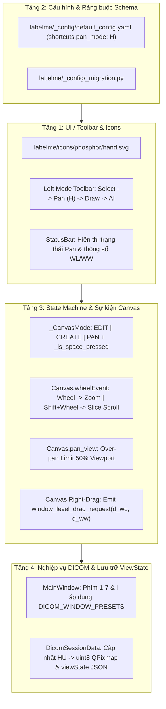

# Kế hoạch Triển khai: Nâng cấp UI/UX & Hệ thống Chuột/Phím tắt Chuẩn Y tế DICOM & Đồ họa 2D/AI (`Labelme`)

## 1. Bối cảnh & Mục tiêu Nghiệp vụ

Sau khi tích hợp thành công lõi đọc ảnh Y tế DICOM 16-bit Hounsfield Unit (`SimpleITK` + `pydicom`) ở phiên bản `v7.12.0`, giao diện điều khiển và cơ chế tương tác chuột/bàn phím trên [`Canvas`](file:///home/apollai/Documents/GitHub/medical/labelme/labelme/_widgets/_canvas.py) của `Labelme` vẫn mang thói quen cuộn văn bản cũ, gây cản trở cho cả **Bác sĩ Chẩn đoán Hình ảnh (CĐHA)** lẫn **Chuyên viên gán nhãn 2D/AI**:
1. **Con lăn chuột (`Wheel`) ngược phản xạ**: Lăn chuột mặc định chỉ cuộn thanh trượt dọc, buộc phải giữ `Ctrl + Lăn chuột` mới phóng to/thu nhỏ được.
2. **Thiếu công cụ Bàn tay (`Pan / Hand Tool`) và bị khóa biên kéo (`constrain_to_center`)**: Khi phóng to vào các tổn thương nằm sát rìa giải phẫu (như nốt mờ dưới màng phổi, ổ nhồi máu sát vỏ não), người dùng không có nút Bàn tay trên thanh công cụ, không dùng được tổ hợp giữ `Space + Kéo chuột trái` khi đang vẽ dở, và bị hàm [`Canvas.pan_view`](file:///home/apollai/Documents/GitHub/medical/labelme/labelme/_widgets/_canvas.py#L514-L536) chặn không cho kéo vùng rìa ảnh vào chính giữa màn hình.
3. **Thao tác đổi cửa sổ tín hiệu DICOM (`WL/WW`) còn qua nhiều bước**: Bác sĩ phải mở hộp thoại [`BrightnessContrastDialog`](file:///home/apollai/Documents/GitHub/medical/labelme/labelme/_widgets/_brightness_contrast_dialog.py) thay vì bấm phím số chuyển nhanh giữa các cửa sổ lâm sàng (*Lung, Soft Tissue, Bone, Brain...*) hoặc kéo chuột phải trực tiếp trên ảnh như trên máy trạm PACS / 3D Slicer.

### Mục tiêu Cốt lõi
Thiết lập hệ thống tương tác **Hybrid Medical-Annotation Ergonomics** kết hợp chuẩn vàng của phần mềm đồ họa 2D/AI (Photoshop, Figma, CVAT) và máy trạm PACS/DICOM Viewer (3D Slicer, RadiAnt):
- **Lăn chuột trực tiếp (`Wheel`)** để Zoom vào/ra ngay tại vị trí trỏ chuột (*Focal Zoom*); dùng **`Shift + Lăn chuột`** (hoặc phím `A`/`D`) để lướt qua các lát cắt Trước/Sau.
- **Cơ chế Pan Kép với biên độ Over-pan 50% Viewport**:
  - Thêm nút công cụ **`Pan` (Icon Bàn tay, phím tắt `H`)** ngay dưới nút `Select` trên thanh công cụ dọc bên trái.
  - Hỗ trợ **Giữ `Space` + Kéo Chuột Trái** (*Spring-loaded Hand Pan*) và **Kéo Chuột Giữa** xuyên suốt mọi chế độ (kể cả khi đang vẽ dở `Polygon` hoặc chấm điểm `AI-Segment` mà không làm mất hay đóng sập nét vẽ đang dở); dành riêng phím **`Enter` (`Return`)** để chốt hình vẽ.
  - Mở khóa giới hạn trong [`Canvas.pan_view`](file:///home/apollai/Documents/GitHub/medical/labelme/labelme/_widgets/_canvas.py#L514-L536) để mọi điểm ảnh ở sát 4 mép ảnh đều có thể được kéo vào đúng tâm khung nhìn (`50% viewport`).
- **Tương tác nhanh DICOM Window/Level ngay trên Canvas**:
  - Bấm phím số **`1`–`7`** để chuyển tức thì giữa 7 Preset lâm sàng (`Auto`, `CT Brain`, `CT Lung`, `CT Soft Tissue`, `CT Liver`, `CT Bone`, `CT Stroke`) và phím **`I`** để đảo ngược âm bản (`Invert Monochrome`).
  - **Nhấn giữ Chuột Phải + Kéo** trên ảnh DICOM để chỉnh trực tiếp `Window Width` (theo phương ngang) và `Window Center` (theo phương dọc) theo thời gian thực, trong khi **Click Chuột Phải tại chỗ** vẫn mở Context Menu như bình thường.

---

## 2. Phân tích Phản biện & Xử lý Rủi ro Kiến trúc (Devil's Advocate)

| Rủi ro / Xung đột Tiềm ẩn | Giải pháp Kiến trúc Chốt chặn |
| :--- | :--- |
| **1. Giữ `Space` khi đang vẽ `Polygon` làm đóng sập hình đang vẽ hoặc mất đoạn dây preview (`_line`)** | Tách phím `Space` ra khỏi nhánh `_finalize()` trong [`Canvas.keyPressEvent`](file:///home/apollai/Documents/GitHub/medical/labelme/labelme/_widgets/_canvas.py#L3204). Khi giữ `Space` (bỏ qua sự kiện `isAutoRepeat`), chỉ bật cờ tạm thời `_is_space_pressed = True` và đổi con trỏ sang `CursorRole.GRAB`. Mọi dữ liệu nháp (`_current`, `_line`, `_ai_segment_result`, `_ai_find_all_draft`) được bảo toàn nguyên vẹn. Khi nhả `Space`, khôi phục con trỏ vẽ và tính lại tọa độ `_line` theo vị trí chuột mới. |
| **2. Vô tình lướt sang lát cắt khác khi đang vẽ dở đa giác nếu chạm `Shift + Wheel`** | Trong [`Canvas.wheelEvent`](file:///home/apollai/Documents/GitHub/medical/labelme/labelme/_widgets/_canvas.py#L3148), nhánh `ShiftModifier` phát tín hiệu chuyển lát cắt sẽ kiểm tra thuộc tính `self.is_interacting`. Nếu người dùng đang vẽ dở hình (`is_drawing`), đang kéo đỉnh (`_is_moving_shape`) hoặc đang có nháp AI (`has_ai_find_all_draft`), hệ thống từ chối chuyển ảnh để bảo vệ trạng thái làm việc. |
| **3. Kéo Chuột Phải chỉnh `WL/WW` xung đột với mở `Context Menu` khi nhả chuột phải** | Trong [`Canvas`](file:///home/apollai/Documents/GitHub/medical/labelme/labelme/_widgets/_canvas.py), khi nhấn `RightButton`, ghi nhận vị trí bắt đầu nhưng chưa kích hoạt chỉnh `WL/WW` cho tới khi độ dịch chuyển chuột vượt ngưỡng `QApplication.startDragDistance()`. Nếu đã vượt ngưỡng và thực hiện kéo `WL/WW` (`_is_wl_dragging = True`), hàm `_release_right` sẽ kết thúc phiên kéo và **không gọi** `menu.exec()`. Nếu người dùng chỉ nhấp chuột phải tại chỗ, Context Menu vẫn bật lên chính xác cho cả chế độ `EDIT` và `CREATE`. |
| **4. Phím tắt số `1`–`7` và `I` bị kích hoạt nhầm khi người dùng đang gõ chữ vào ô tìm kiếm file hoặc ô AI Prompt** | Các QAction/sự kiện phím tắt Preset DICOM chỉ kích hoạt khi đang mở phiên DICOM (`_dicom_session is not None`) và widget đang giữ focus **không phải** là ô nhập liệu văn bản (`QLineEdit`, `QTextEdit`, `QPlainTextEdit`, `QAbstractSpinBox`). |

---

## 3. Định vị Thiết kế Xuyên 4 Tầng (4-Layer Architecture Mapping)

### 3.1. Tầng Giao diện & Biểu tượng (`UI / Toolbar / Icons`)
- **Biểu tượng mới**: Tạo file [`labelme/icons/phosphor/hand.svg`](file:///home/apollai/Documents/GitHub/medical/labelme/labelme/icons/phosphor/hand.svg) theo chuẩn vector đơn sắc `viewBox="0 0 256 256" fill="currentColor"` đồng bộ với bộ icon Phosphor hiện hữu trong [`labelme/_utils/_qt.py`](file:///home/apollai/Documents/GitHub/medical/labelme/labelme/_utils/_qt.py).
- **Thanh công cụ dọc bên trái (`CreateShapeTools`)** trong [`MainWindow._setup_actions`](file:///home/apollai/Documents/GitHub/medical/labelme/labelme/_app.py#L513-L1197) và [`MainWindow._setup_toolbars`](file:///home/apollai/Documents/GitHub/medical/labelme/labelme/_app.py#L1342-L1394):
  - Bổ sung action `pan_mode` (nhãn `"&Pan"`, nhãn toolbar `"Pan"`, phím tắt `H` từ `shortcuts["pan_mode"]`, icon `"phosphor/hand.svg"`, `checkable=True`).
  - Đặt `pan_mode` nằm ngay dưới `edit_mode` (`Select`), phía trên thanh phân cách với nhóm công cụ vẽ hình học.
  - Đưa `pan_mode` vào `canvas_context_menu` và `edit_menu` để đồng bộ khả năng truy cập.

### 3.2. Tầng Cấu hình & Kiểm tra Dữ liệu (`Config & Validation`)
- **Cấu hình mặc định**: Cập nhật [`labelme/_config/default_config.yaml`](file:///home/apollai/Documents/GitHub/medical/labelme/labelme/_config/default_config.yaml#L98-L141) bổ sung `pan_mode: H` vào mục `shortcuts`.
- **Kiểm tra tính hợp lệ**: Đảm bảo bộ nạp cấu hình [`labelme/_config/__init__.py`](file:///home/apollai/Documents/GitHub/medical/labelme/labelme/_config/__init__.py) chấp nhận khóa `shortcuts.pan_mode` hợp lệ và không ảnh hưởng tới các file cấu hình cũ của người dùng.

### 3.3. Tầng Máy trạng thái & Tương tác Khung vẽ (`Canvas Interaction & State Machine`)
Tại [`labelme/_widgets/_canvas.py`](file:///home/apollai/Documents/GitHub/medical/labelme/labelme/_widgets/_canvas.py):
- **Mở rộng chế độ Canvas (`_CanvasMode`)**:
  - Bổ sung giá trị `PAN` vào enum `_CanvasMode` (cùng với `CREATE` và `EDIT`).
  - Cập nhật hàm `set_editing` (hoặc bổ sung phương thức chuyển chế độ trên `Canvas` và `MainWindow._switch_canvas_mode`) để hỗ trợ chuyển sang `_CanvasMode.PAN`, bỏ chọn hình đang hover và đặt con trỏ mặc định là `CursorRole.GRAB` (`OpenHandCursor`).
- **Cơ chế `Spring-loaded Hand Pan` (`Giữ Space + Kéo Chuột Trái`)**:
  - Quản lý cờ `_is_space_pressed` trong `keyPressEvent`, `keyReleaseEvent` và `focusOutEvent`.
  - Loại bỏ `Qt.Key.Key_Space` khỏi tổ hợp phím đóng hình `_finalize()` trong `keyPressEvent` (chỉ giữ `Qt.Key.Key_Return` và `Qt.Key.Key_Enter`); cập nhật chuỗi hướng dẫn trong `_update_status` thành `"Enter to finalize"`.
  - Trong `_dispatch_pointer_press`, `_dispatch_pointer_move`, `_dispatch_pointer_release`: Khi nhấn chuột trái trong lúc `self.mode == _CanvasMode.PAN` hoặc `self._is_space_pressed == True`, hoặc khi nhấn `MiddleButton`, gọi `_begin_pan` (đổi con trỏ sang `CursorRole.MOVE` / `ClosedHandCursor`), phát `pan_request` khi di chuột, và gọi `_finish_pan` khi nhả chuột mà không tác động tới `_current` hay `selected_shapes`.
- **Mở khóa Biên độ Kéo Rìa Ảnh (`Over-pan Limit 50% Viewport`)**:
  - Cho phép bắt đầu Pan ngay cả khi ảnh chưa tràn khung nhìn (`not self.pixmap.isNull()`).
  - Trong [`Canvas.pan_view`](file:///home/apollai/Documents/GitHub/medical/labelme/labelme/_widgets/_canvas.py#L514-L536), nới rộng giới hạn `x_limit` và `y_limit` thành giá trị lớn nhất giữa `viewport.width() / 2.0`, `(self.pixmap.width() * self.scale) / 2.0` và `abs(self._view_offset.x())` (tương tự cho trục Y). Nhờ đó, khi thanh cuộn chạm biên ảnh, phần dịch chuyển dư sẽ được cộng vào `_view_offset` cho phép đưa sát mép ảnh vào đúng chính giữa màn hình (`50% viewport`).
- **Quy hoạch lại Con lăn chuột (`Canvas.wheelEvent`)**:
  - Khi không giữ phím bổ trợ (`NoModifier`) hoặc giữ `ControlModifier`: Phát `zoom_request.emit(delta.y(), a0.position())` để phóng to/thu nhỏ tại trỏ chuột.
  - Khi giữ `ShiftModifier`: Nếu `not self.is_interacting` và `delta.y() != 0`, phát tín hiệu mới `slice_scroll_request.emit(delta.y())` để `MainWindow` chuyển sang ảnh trước (`delta.y() > 0`) hoặc ảnh sau (`delta.y() < 0`).
  - Khi giữ `AltModifier`: Phát `scroll_request` để cuộn thanh trượt dọc/ngang truyền thống.
- **Kéo Chuột Phải chỉnh trực tiếp `WL/WW` (`window_level_drag_request`)**:
  - Khai báo tín hiệu `window_level_drag_request = QtCore.Signal(float, float)` trên `Canvas` và thuộc tính `_is_dicom_active: bool` (do `MainWindow` bật khi mở file DICOM).
  - Khi `_is_dicom_active` là `True` và người dùng nhấn giữ `RightButton` kéo vượt ngưỡng `startDragDistance()`, tính độ lệch pixel `dx` (ngang) và `dy` (dọc) giữa các bước di chuyển chuột, phát `window_level_drag_request.emit(delta_wc, delta_ww)` và đánh dấu `_is_wl_dragging = True` để chặn mở Context Menu khi nhả nút chuột phải.

### 3.4. Tầng Nghiệp vụ DICOM & Đồng bộ Trạng thái (`MainWindow & DicomSessionData`)
Tại [`labelme/_app.py`](file:///home/apollai/Documents/GitHub/medical/labelme/labelme/_app.py) và [`labelme/_dicom.py`](file:///home/apollai/Documents/GitHub/medical/labelme/labelme/_dicom.py):
- **Xử lý tín hiệu kéo `WL/WW` thời gian thực (`_on_window_level_drag_requested`)**:
  - Kết nối `canvas.window_level_drag_request` tới phương thức xử lý trong `MainWindow`.
  - Cộng dồn `delta_wc` vào `_dicom_session.window_center` (kẹp trong dải hợp lệ `[-2048.0, 4096.0]` hoặc min/max của `hu_array`) và `delta_ww` vào `_dicom_session.window_width` (kẹp tối thiểu `1.0`), đặt `preset_name = "custom"`, cập nhật lại `QPixmap` trên `Canvas` (`clear_shapes=False`), lưu vào `_dicom_view_states` và hiển thị thông số `WL / WW` tức thì trên thanh trạng thái `statusBar()`.
- **Hệ thống Phím tắt Nhanh DICOM Presets (`1`–`7` và `I`)**:
  - Thiết lập các phím tắt hoặc bộ xử lý phím trên `MainWindow` cho ảnh DICOM (chỉ hoạt động khi `_dicom_session is not None` và không focus vào ô nhập chữ):
    - `1` $\rightarrow$ `auto`
    - `2` $\rightarrow$ `ct_brain` (`WL: 40, WW: 80`)
    - `3` $\rightarrow$ `ct_lung` (`WL: -600, WW: 1500`)
    - `4` $\rightarrow$ `ct_soft_tissue` (`WL: 40, WW: 400`)
    - `5` $\rightarrow$ `ct_liver` (`WL: 60, WW: 160`)
    - `6` $\rightarrow$ `ct_bone` (`WL: 400, WW: 1800`)
    - `7` $\rightarrow$ `ct_stroke` (`WL: 32, WW: 8`)
    - `I` $\rightarrow$ Đảo ngược `is_inverted` (`Invert Monochrome`)
  - Đồng bộ trạng thái qua hàm dùng chung `_apply_dicom_window_state` để cập nhật cả `Canvas`, `_dicom_view_states`, `_annotation.other_data["dicom"]` và thông báo trên thanh trạng thái.

---

## 4. Trạng thái Câu hỏi Mở (Open Questions)

Tất cả các câu hỏi thiết kế đã được Kiến trúc sư Hệ thống xác nhận:
- [x] **Con lăn chuột (`Wheel`)**: Mặc định `Wheel` = Focal Zoom tại trỏ chuột; `Shift + Wheel` (cùng `A`/`D`) = Chuyển lát cắt Trước/Sau.
- [x] **Công cụ Pan & Phím `Space`**: Bổ sung cả nút `Pan (H)` trên Left Toolbar lẫn cơ chế giữ `Space + Kéo chuột trái` ngay khi đang vẽ `Polygon` / `AI-Segment`; dùng phím `Enter` để chốt hình.
- [x] **Tương tác nhanh DICOM WL/WW**: Bổ sung phím số `1`–`7` (Presets) + `I` (Invert) và kéo Chuột Phải chỉnh trực tiếp `WL/WW` trên Canvas.
- [x] **Biên độ Over-pan**: Cho phép kéo vùng rìa ảnh vào tới chính giữa khung nhìn (`50% viewport`).
