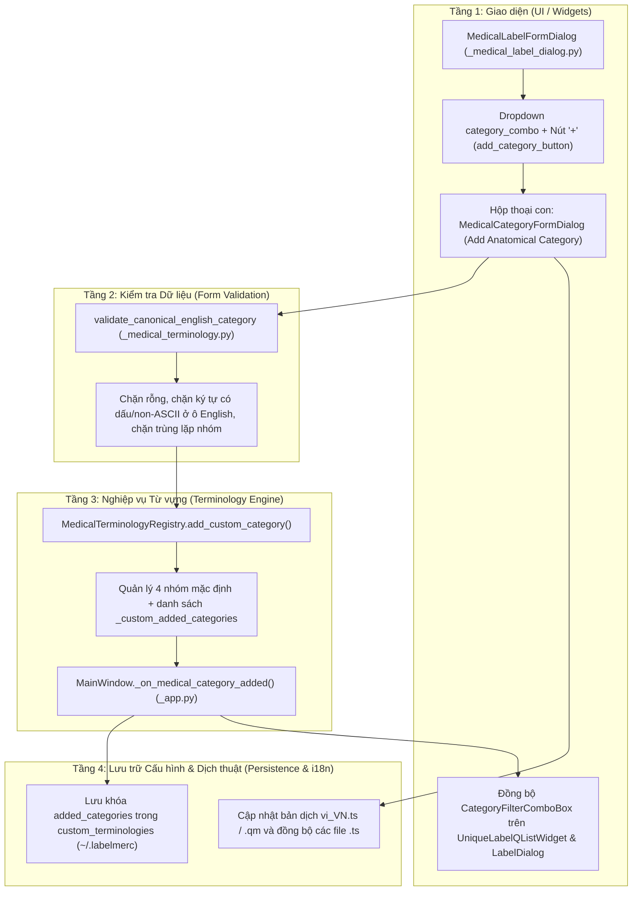

# Kế hoạch Triển khai: Hộp thoại Thêm Nhóm Giải Phẫu Y Khoa (`plan_medical_terminology_categories.md`)

## 1. Tổng quan & Nguyên tắc Cốt lõi

Nâng cấp luồng quản lý **Nhóm giải phẫu (`Anatomical Category`)** trong hộp thoại **Add Medical Label (`MedicalLabelFormDialog`)** để bác sĩ có thể trực tiếp thêm nhóm giải phẫu mới qua một hộp thoại nhỏ chuyên biệt **Add Anatomical Category (`MedicalCategoryFormDialog`)**, trong khi vẫn giữ nguyên 4 nhóm mặc định của bộ nhãn X-quang ngực (`chest_xray`).

> [!IMPORTANT]
> **Hai Nguyên tắc Bất biến của Hệ thống:**
>
> 1. **Chuẩn hóa Tiếng Anh cho AI (`Canonical English Standard`)**:
>    - Mọi định danh phục vụ AI (`canonical_label` lưu vào file `.json`, `category_id` và `en_name` của nhóm giải phẫu) bắt buộc sử dụng Tiếng Anh chuẩn (ASCII, không dấu).
> 2. **Tách bạch Chuỗi Hiển thị Bản địa hóa (`Localized UI & Display Text`)**:
>    - Toàn bộ nhãn giao diện (tiêu đề hộp thoại, nhãn trường nhập, placeholder, nút bấm, thông báo lỗi) đều đi qua hệ thống dịch thuật `tr()` / `translate()` của Qt (`.ts` / `.qm`).
>    - Mỗi Nhóm giải phẫu (`TerminologyCategory`) và Nhãn y khoa (`TerminologyItem`) đều lưu cặp tên Song ngữ: Tên chuẩn Tiếng Anh (`en_name`) và Tên hiển thị bản địa (`vi_name`) để tự động chuyển đổi theo ngôn ngữ giao diện đang bật.

______________________________________________________________________

## 2. Thiết kế Kiến trúc Xuyên 4 Tầng (4-Layer Architecture)

### Tầng 1 — Giao diện (`UI / Widgets` — \[`_medical_label_dialog.py`\](file:///home/apollai/Documents/GitHub/medical/labelme/labelme/\_widgets/\_medical_label_dialog.py))

- **Cải tiến dòng `Anatomical Category:` trên \[`MedicalLabelFormDialog`\](file:///home/apollai/Documents/GitHub/medical/labelme/labelme/\_widgets/\_medical_label_dialog.py#L183-L342)**:
  - Thay vì dùng combobox `setEditable(True)` gây hiểu lầm là chỉ có 4 nhóm cố định, chuyển `category_combo` (`_CategorySelectorComboBox`) về chế độ **Dropdown danh sách chuẩn (`setEditable(False)`)** hiển thị tên nhóm theo ngôn ngữ giao diện hiện tại (`cat.display_name(locale=...)`).
  - Cuối danh sách xổ xuống của `category_combo` có mục đặc biệt **`+ Add New Category…`** (*`+ Thêm nhóm giải phẫu mới…`*, mã sentinel `NEW_CATEGORY_SENTINEL = "__new_category__"`).
  - Đặt thêm một nút **`+` (`add_category_button`: `QToolButton`, `objectName="add_category_button"`)** nằm ngay bên phải `category_combo` trên cùng một hàng ngang (`QHBoxLayout`).
  - Khi người dùng bấm nút `+` (`add_category_button`) hoặc chọn dòng `+ Add New Category…` trong danh sách xổ xuống:
    - Mở hộp thoại nhỏ **`Add Anatomical Category` (`MedicalCategoryFormDialog`)**.
    - Nếu người dùng tạo nhóm thành công (`Accepted`): Nhóm mới được thêm ngay vào `category_combo`, tự động được chọn làm nhóm hiện tại, đồng thời kích hoạt callback đồng bộ ra bên ngoài.
    - Nếu người dùng bấm `Cancel` (`Rejected`): `category_combo` tự động khôi phục lại nhóm đang chọn trước đó.
  - Vẫn hỗ trợ phương thức `category_combo.setCurrentText(...)` để tương thích ngược 100% với các bài kiểm thử tự động hiện hữu.
- **Xây dựng Hộp thoại nhỏ `MedicalCategoryFormDialog` (`Add Anatomical Category`)**:
  - Tiêu đề cửa sổ: `Add Anatomical Category` (*`Thêm nhóm giải phẫu`*).
  - Gồm 2 trường nhập liệu rõ ràng:
    1. `Canonical English Category *:` (`english_category_edit`, `objectName="english_category_edit"`) — Bắt buộc nhập tên Tiếng Anh chuẩn (VD: `e.g. Chest wall / Bones (Canonical English)`).
    2. `Localized Display Name:` (`vietnamese_category_edit`, `objectName="vietnamese_category_edit"`) — Tùy chọn nhập tên hiển thị theo ngôn ngữ bản địa (VD: `Display name in local language (Optional)`).
  - Nhãn báo lỗi `error_label` (`objectName="error_label"`) và cụm nút `OK` (`ok_button`) / `Cancel` (`cancel_button`).

### Tầng 2 — Kiểm tra Dữ liệu (`Validation Layer` — \[`_medical_terminology.py`\](file:///home/apollai/Documents/GitHub/medical/labelme/labelme/\_medical_terminology.py))

- Bổ sung hàm kiểm tra hợp lệ `validate_canonical_english_category`:
  - Kiểm tra trường `Canonical English Category *` không được để trống.
  - Kiểm tra chỉ chứa ký tự Tiếng Anh chuẩn (printable ASCII, có ít nhất 1 chữ cái tiếng Anh). Nếu người dùng nhập tiếng Việt có dấu vào ô English, hiển thị thông báo lỗi hướng dẫn nhập tên Tiếng Anh không dấu vào ô trên và tên bản địa vào ô `Localized Display Name` ở dưới.
  - Kiểm tra chống trùng lặp (case-insensitive) với 4 nhóm mặc định và các nhóm đã có trong Preset hiện tại (so khớp cả `category_id`, `en_name` và `vi_name`).

### Tầng 3 — Nghiệp vụ & Từ vựng Y khoa (\[`_medical_terminology.py`\](file:///home/apollai/Documents/GitHub/medical/labelme/labelme/\_medical_terminology.py) & \[`_app.py`\](file:///home/apollai/Documents/GitHub/medical/labelme/labelme/\_app.py))

- Giữ nguyên **4 nhóm mặc định** của `CHEST_XRAY_CATEGORIES` (*Lung parenchyma*, *Pleura*, *Hilum / Mediastinum*, *Heart / Diaphragm / Trachea*).
- Bổ sung phương thức `MedicalTerminologyRegistry.add_custom_category(en_name, vi_name, preset_id)`:
  - Tạo đối tượng `TerminologyCategory` với `category_id = slugify_identifier(text=en_name)`, `en_name` chuẩn hóa, và `vi_name` (nếu để trống thì lấy `en_name`).
  - Thêm vào `preset.categories` và lưu vết vào `_custom_added_categories[preset.preset_id]`.
- Trên \[`MainWindow`\](file:///home/apollai/Documents/GitHub/medical/labelme/labelme/\_app.py#L4492-L4516), bổ sung callback `_on_medical_category_added` để ngay khi bác sĩ thêm nhóm mới từ `MedicalCategoryFormDialog`, hệ thống tự động lưu vào `~/.labelmerc` và làm mới danh sách nhóm trên `UniqueLabelQListWidget` cũng như `LabelDialog`.

### Tầng 4 — Lưu trữ Cấu hình & Đa ngôn ngữ (`Persistence & i18n`)

- **Lưu trữ bền vững (`to_custom_config` & `load_custom_config`)**:
  - Mở rộng cấu trúc `custom_terminologies` trong `~/.labelmerc` để lưu thêm khóa `added_categories` theo từng `preset_id`. Nhờ đó, ngay cả khi bác sĩ mới chỉ tạo nhóm giải phẫu mà chưa thêm nhãn hoặc đóng ứng dụng mở lại, nhóm giải phẫu mới vẫn được bảo toàn đầy đủ cả tên Tiếng Anh lẫn tên Tiếng Việt.
- **Biên dịch Đa ngôn ngữ (\[`vi_VN.ts`\](file:///home/apollai/Documents/GitHub/medical/labelme/labelme/translate/vi_VN.ts) & `.qm`)**:
  - Bổ sung context `MedicalCategoryFormDialog` và các chuỗi dịch mới trong `MedicalLabelFormDialog` vào toàn bộ các file `.ts` và biên dịch lại `vi_VN.qm`, đảm bảo `just check_translate` và `just lint` đạt 100%.

______________________________________________________________________

## 3. Khắc phục Triệt để Lỗi Không Gõ Được Tiếng Việt Có Dấu trên Mọi Ô Input (IME & Search Fix)

### 3.1. Chẩn đoán Nguyên nhân Gốc rễ (2 Nguyên nhân Kết hợp)

1. **Nguyên nhân 1 (Tầng Runtime / Hệ thống — Mất kết nối bộ gõ Fcitx5 trên PySide6 Linux/Wayland)**:
   - Trên máy Linux của người dùng, bộ gõ Tiếng Việt chạy qua tiến trình **`/usr/bin/fcitx5`** với biến môi trường `QT_IM_MODULE=fcitx`.
   - Tuy nhiên, gói `PySide6` (Qt 6.11.1 trong `.venv`) chỉ đóng gói 3 plugin trong `PySide6/Qt/plugins/platforminputcontexts/`: `libibusplatforminputcontextplugin.so` (`ibus`), `libcomposeplatforminputcontextplugin.so` (`compose`) và `libqtvirtualkeyboardplugin.so`. PySide6 **không có** `libfcitx5platforminputcontextplugin.so`.
   - Khi `QApplication` khởi động với `QT_IM_MODULE=fcitx`, Qt không tìm thấy plugin `"fcitx"` nên âm thầm rơi về `libcomposeplatforminputcontextplugin.so` (`compose`), làm ngắt hoàn toàn kết nối với bộ gõ Fcitx5 trên **tất cả các ô `QLineEdit` / `QTextEdit` trong toàn bộ ứng dụng** (từ ô search nhãn, ô tìm file đến các ô Localized Display Name).
   - Ngoài ra, Fcitx5 cung cấp sẵn giao diện tương thích IBus qua D-Bus (`org.freedesktop.portal.IBus`), nhưng trong file socket `~/.config/ibus/bus/...` do Fcitx5 sinh ra lại đính kèm tham số `,fcitx_random_string=...` khiến `QIbusPlatformInputContext` của Qt 6.11 từ chối kết nối nếu không bật `IBUS_USE_PORTAL=1`.
2. **Nguyên nhân 2 (Tầng Widget \[`LabelDialog.edit`\](file:///home/apollai/Documents/GitHub/medical/labelme/labelme/\_widgets/\_label_dialog.py#L478-L532) — `InlineCompletion` nuốt ký tự đang ghép dấu Tiếng Việt)**:
   - Trên ô tìm kiếm nhãn `LabelDialog.edit`, khi `QCompleter` chạy ở chế độ `InlineCompletion` (`completion="startswith"`), ngay khi người dùng gõ chữ cái đầu tiên (VD: gõ `"D"` để gõ `"Đám mờ"`, hoặc `"T"` để gõ `"Tràn dịch"`), `QCompleter` lập tức tự động điền và bôi đen phần đuôi của nhãn đầu tiên (`"D[ày màng phổi]"`, `"T[ổn thương dạng kẽ]"`).
   - Sau đó `_on_text_changed` lấy toàn bộ chuỗi `self.edit.text()` (bao gồm cả phần đuôi tự điền `"ày màng phổi"`) đưa vào `_filter_medical_items_by_search`, khiến các nhãn cần tìm (*Đám mờ phổi*, *Đông đặc phổi*, *Tràn dịch màng phổi*, *Tim to*...) bị ẩn mất ngay lập tức và làm bộ đệm ghép dấu Telex/VNI bị đứt quãng!

### 3.2. Giải pháp Khắc phục Xuyên Tầng

- **Tầng Khởi tạo Ứng dụng (\[`labelme/__main__.py`\](file:///home/apollai/Documents/GitHub/medical/labelme/labelme/__main__.py#L286-L324) — `_configure_linux_input_method`)**:
  - Trước khi khởi tạo `QtWidgets.QApplication(sys.argv)` trên Linux:
    - Kiểm tra nếu `QT_IM_MODULE` đang là `"fcitx"` hoặc `"fcitx5"` (hoặc `XMODIFIERS` chứa `@im=fcitx`) mà thư mục `platforminputcontexts` của PySide6 không có plugin `fcitx`, tự động chuyển cầu nối sang IBus Portal của Fcitx5 bằng cách thiết lập `QT_IM_MODULE="ibus"` và `IBUS_USE_PORTAL="1"`.
    - Nếu `QT_IM_MODULE` đang là `"ibus"` và file cấu hình bus trong `~/.config/ibus/bus/` là của Fcitx5 (`fcitx_random_string`), tự động bật `IBUS_USE_PORTAL="1"` để `QIbusPlatformInputContext` kết nối thẳng tới `org.freedesktop.portal.IBus` (`>>>> bus connected!`).
- **Tầng Widget Tìm kiếm Nhãn (\[`labelme/_widgets/_label_dialog.py`\](file:///home/apollai/Documents/GitHub/medical/labelme/labelme/\_widgets/\_label_dialog.py#L478-L568))**:
  - **Không để `InlineCompletion` phá quá trình gõ tìm kiếm bộ nhãn y khoa**:
    - Trong `_on_text_changed` / `_filter_medical_items_by_search`: Khi lọc danh sách nhãn y khoa (`_has_medical_items()`), nếu `self.edit` đang có phần đuôi gợi ý do `InlineCompletion` tự bôi đen (`selectedText` nằm ở cuối chuỗi khi con trỏ ở cuối), hoặc khi đang gõ tìm kiếm y khoa, chỉ dùng **phần tiền tố thực sự do người dùng gõ** (không lấy phần đuôi do `InlineCompletion` tự động chèn) để lọc `_filter_medical_items_by_search`, hoặc tắt can thiệp `InlineCompletion` trực tiếp lên ô `self.edit` khi đang ở chế độ bộ nhãn y khoa có bộ lọc danh sách riêng (trong khi vẫn giữ `self.edit.completer()` cho các bộ nhãn thường để tương thích ngược 100% với toàn bộ bài test `completion`).
  - **Hỗ trợ sự kiện `QInputMethodEvent` (Preedit Tiếng Việt)** trên `self.edit`:
    - Trong `LabelDialog.eventFilter`, lắng nghe `QtCore.QEvent.Type.InputMethod` (`QtGui.QInputMethodEvent`) trên `self.edit` để khi bộ gõ Tiếng Việt đang ở trạng thái gạch chân ghép chữ (`preeditString()`), bộ lọc `_filter_medical_items_by_search` và trạng thái nút `OK` cập nhật tức thời theo chuỗi `text + preeditString()`.
- **Tầng Chuẩn hóa Unicode (\[`labelme/_medical_terminology.py`\](file:///home/apollai/Documents/GitHub/medical/labelme/labelme/\_medical_terminology.py))**:
  - Chuẩn hóa `unicodedata.normalize("NFC", ...)` cho tất cả chuỗi Tiếng Việt nhập từ các ô `vietnamese_label_edit`, `short_vietnamese_edit`, `vietnamese_category_edit` và từ khóa tìm kiếm `query` để tương thích tuyệt đối với cả bộ gõ xuất Unicode dựng sẵn (NFC) lẫn tổ hợp (NFD).

______________________________________________________________________

## 4. Thiết kế Full CRUD: Chỉnh sửa (`Edit`) & Xóa (`Delete`) Nhãn và Nhóm Giải Phẫu (Bao gồm cả Dữ liệu Preset)

> [!IMPORTANT]
> **Nguyên tắc Nghiệp vụ:**
> Bộ 4 nhóm và 21 nhãn X-quang ngực ban đầu chỉ là dữ liệu **Preset khởi tạo sẵn**. Bác sĩ có toàn quyền **Thêm (`+`), Sửa (`✎`), Xóa (`-`)** bất kỳ Nhãn y khoa nào và bất kỳ Nhóm giải phẫu nào (kể cả dữ liệu mặc định trong Preset) và mọi thay đổi đều được lưu bền vững vào `~/.labelmerc`.

### 4.1. Định vị Kiến trúc 4 Tầng cho Luồng Edit & Delete

#### Tầng 1 — Giao diện (`UI / Widgets` — \[`_medical_label_dialog.py`\](file:///home/apollai/Documents/GitHub/medical/labelme/labelme/\_widgets/\_medical_label_dialog.py), \[`_unique_label_qlist_widget.py`\](file:///home/apollai/Documents/GitHub/medical/labelme/labelme/\_widgets/\_unique_label_qlist_widget.py), \[`_label_dialog.py`\](file:///home/apollai/Documents/GitHub/medical/labelme/labelme/\_widgets/\_label_dialog.py))

1. **Chỉnh sửa & Xóa Nhóm Giải Phẫu (`Anatomical Category`)**:
   - Trên dòng `Anatomical Category:` của \[`MedicalLabelFormDialog`\](file:///home/apollai/Documents/GitHub/medical/labelme/labelme/\_widgets/\_medical_label_dialog.py), cụm nút bên cạnh `category_combo` gồm đủ 3 nút thao tác:
     - **`+` (`add_category_button`, `objectName="add_category_button"`)**: Mở `MedicalCategoryFormDialog` ở chế độ **Add Anatomical Category** (*`Thêm nhóm giải phẫu`*).
     - **`✎` (`edit_category_button`, `objectName="edit_category_button"`)**: Mở `MedicalCategoryFormDialog` ở chế độ **Edit Anatomical Category** (*`Sửa nhóm giải phẫu`*) với tham số `editing_category: TerminologyCategory`, nạp sẵn `en_name` và `vi_name` của nhóm đang chọn.
     - **`-` (`delete_category_button`, `objectName="delete_category_button"`)**: Khi bấm vào, **bắt buộc hiển thị hộp thoại xác nhận (`QMessageBox.question` với 2 nút `Yes | No`, mặc định focus vào `No`)**:
       - Tiêu đề: `Delete Anatomical Category` (*`Xóa nhóm giải phẫu`*).
       - Nội dung cảnh báo rõ tên nhóm và số lượng nhãn bên trong: `Are you sure you want to delete category '{category}' and its {count} label(s)?` (*`Bạn có chắc chắn muốn xóa nhóm '{category}' cùng {count} nhãn bên trong không?`*).
       - Chỉ khi bác sĩ bấm **`Yes`** mới thực hiện xóa; nếu bấm **`No`** hoặc đóng hộp thoại thì hủy thao tác, bảo toàn 100% dữ liệu.
   - Đồng thời hỗ trợ menu chuột phải (Context Menu) trên `CategoryFilterComboBox` (`category_combo` ở bảng bên phải và trong `LabelDialog`) để bác sĩ có thể bấm chuột phải vào thanh chọn nhóm và chọn nhanh: `Add Anatomical Category…`, `Edit Anatomical Category…`, `Delete Anatomical Category` (cũng qua bước confirm `Yes | No`).
2. **Chỉnh sửa & Xóa Nhãn Y Khoa (`Medical Label`)**:
   - Trên thanh công cụ của bảng **`Label List` bên phải (\[`UniqueLabelQListWidget`\](file:///home/apollai/Documents/GitHub/medical/labelme/labelme/\_widgets/\_unique_label_qlist_widget.py))** và hộp thoại **\[`LabelDialog`\](file:///home/apollai/Documents/GitHub/medical/labelme/labelme/\_widgets/\_label_dialog.py)**:
     - Bên cạnh `category_combo` và nút **`+` (`add_label_button`)**, bổ sung:
       - Nút **`✎` (`edit_label_button`, `objectName="edit_label_button"`)**: Mở `MedicalLabelFormDialog` ở chế độ **Edit Medical Label** (*`Sửa nhãn y khoa`*) cho nhãn đang được chọn.
       - Nút **`-` (`delete_label_button`, `objectName="delete_label_button"`)**: Khi bấm vào (hoặc chọn xóa từ menu chuột phải), **bắt buộc hiển thị hộp thoại xác nhận (`QMessageBox.question` với 2 nút `Yes | No`, mặc định focus vào `No`)**:
         - Tiêu đề: `Delete Medical Label` (*`Xóa nhãn y khoa`*).
         - Nội dung: `Are you sure you want to delete label '{label}'?` (*`Bạn có chắc chắn muốn xóa nhãn '{label}' không?`*).
         - Chỉ khi bác sĩ bấm **`Yes`** mới xóa nhãn khỏi bộ từ vựng; nếu bấm **`No`** thì giữ nguyên.
     - **Lưu ý hiển thị trên Dock hẹp (`UniqueLabelQListWidget`)**: Để đảm bảo khi thu hẹp dock bên phải xuống `180px` toàn bộ các nút vẫn nằm gọn trong viewport mà không sinh thanh cuộn ngang (`test_narrow_dock_keeps_edit_and_add_buttons_inside_viewport`), các nút `+`, `✎`, `-` dùng kích thước nhỏ gọn (`FixedWidth` 22–24px, `spacing=2`) và `category_combo` có `minimumWidth` linh hoạt.
   - Bổ sung **Menu chuột phải (Context Menu)** trên từng dòng nhãn của `UniqueLabelQListWidget` và `LabelDialog.label_list`:
     - `Edit Medical Label…` (*`Sửa nhãn y khoa…`*)
     - `Delete Medical Label` (*`Xóa nhãn y khoa`*)
   - Nâng cấp \[`MedicalLabelFormDialog`\](file:///home/apollai/Documents/GitHub/medical/labelme/labelme/\_widgets/\_medical_label_dialog.py) hỗ trợ tham số `editing_item: TerminologyItem | None = None`:
     - Khi `editing_item` khác `None`, đổi tiêu đề cửa sổ thành `Edit Medical Label` (*`Sửa nhãn y khoa`*), điền sẵn 6 trường (`english_label_edit`, `vietnamese_label_edit`, `short_english_edit`, `short_vietnamese_edit`, `category_combo`, `color_button`).

#### Tầng 2 — Kiểm tra Dữ liệu (`Validation Layer` — \[`_medical_terminology.py`\](file:///home/apollai/Documents/GitHub/medical/labelme/labelme/\_medical_terminology.py))

- Khi **Sửa Nhãn (`update_custom_label`)**:
  - Cho phép giữ nguyên `canonical_label` của chính nhãn đang sửa mà không báo lỗi trùng lặp (`exclude_label=original_canonical_label`), nhưng nếu đổi sang tên Tiếng Anh khác thì vẫn kiểm tra chuẩn ASCII Tiếng Anh và chống trùng lặp với các nhãn còn lại.
- Khi **Sửa Nhóm (`update_custom_category`)**:
  - Cho phép giữ nguyên `en_name` của chính nhóm đang sửa (`exclude_category_id=original_category_id`), nhưng nếu đổi sang tên mới thì kiểm tra chuẩn ASCII Tiếng Anh và chống trùng lặp với các nhóm còn lại.

#### Tầng 3 — Nghiệp vụ Từ vựng & Đồng bộ Hình vẽ (\[`_medical_terminology.py`\](file:///home/apollai/Documents/GitHub/medical/labelme/labelme/\_medical_terminology.py) & \[`_app.py`\](file:///home/apollai/Documents/GitHub/medical/labelme/labelme/\_app.py))

- Bổ sung 4 phương thức CRUD trong `MedicalTerminologyRegistry`:
  1. `update_label(original_canonical_label, canonical_label, vi_full, en_short, vi_short, category_name, color, preset_id) -> TerminologyItem`:
     - Cập nhật trực tiếp tại đúng vị trí index của nhãn trong `preset.items` (giữ nguyên thứ tự danh sách).
  2. `delete_label(canonical_label, preset_id) -> TerminologyItem`:
     - Xóa nhãn khỏi `preset.items` (dù là nhãn mặc định hay nhãn tự thêm).
  3. `update_category(original_category_id, en_name, vi_name, preset_id) -> TerminologyCategory`:
     - Cập nhật `TerminologyCategory` tại đúng vị trí trong `preset.categories`, đồng thời cập nhật toàn bộ các `TerminologyItem` đang thuộc `original_category_id` sang `(new_cat.category_id, new_cat.en_name, new_cat.vi_name)`.
  4. `delete_category(category_id, preset_id, delete_items=True) -> TerminologyCategory`:
     - Xóa nhóm khỏi `preset.categories` (và xóa các nhãn thuộc nhóm đó khỏi `preset.items` khi `delete_items=True`).
- Trên \[`MainWindow`\](file:///home/apollai/Documents/GitHub/medical/labelme/labelme/\_app.py):
  - Khi bác sĩ **Sửa một Nhãn** (đổi `old_canonical` $\\rightarrow$ `new_item.canonical_label` hoặc đổi màu/tên hiển thị):
    - Tự động duyệt các `Shape` đang có trên ảnh hiện tại: mọi `shape` có `shape.label == old_canonical` được cập nhật sang `new_item.canonical_label`, làm mới màu sắc và tên hiển thị trên `Canvas`, `Shape List` (`label_list`), `UniqueLabelQListWidget` và `LabelDialog`.
  - Khi bác sĩ **Xóa một Nhãn** hoặc **Xóa một Nhóm**:
    - Xóa khỏi danh sách `settings_labels` trên `UniqueLabelQListWidget` và `LabelDialog`, lưu cấu hình vào `~/.labelmerc`. Nếu ảnh hiện tại đang có hình vẽ dùng nhãn vừa xóa thì nhãn đó vẫn được bảo toàn dưới mục `Found in files` của ảnh đó để không làm hỏng dữ liệu hình vẽ.

#### Tầng 4 — Lưu trữ Bền vững Mọi Thay đổi trên Preset (`to_custom_config` & `load_custom_config`)

- Ngoài `added_categories` và `added_items`, cấu trúc `custom_terminologies` trong `~/.labelmerc` lưu thêm:
  - `deleted_category_ids`: Danh sách `category_id` đã bị xóa theo từng `preset_id`.
  - `updated_categories`: Danh sách các nhóm đã được chỉnh sửa theo từng `preset_id`.
  - `deleted_labels`: Danh sách `canonical_label` đã bị xóa theo từng `preset_id`.
  - `updated_items`: Danh sách các nhãn đã được chỉnh sửa theo từng `preset_id`.
- Khi `load_custom_config()` chạy lúc khởi động ứng dụng: áp dụng đầy đủ các thao tác `deleted` $\\rightarrow$ `updated` $\\rightarrow$ `added` lên Preset `chest_xray`, đảm bảo bác sĩ xóa hay sửa bất kỳ nhãn/nhóm mặc định nào thì lần sau mở app vẫn giữ nguyên trạng thái đã chỉnh sửa 100%.
