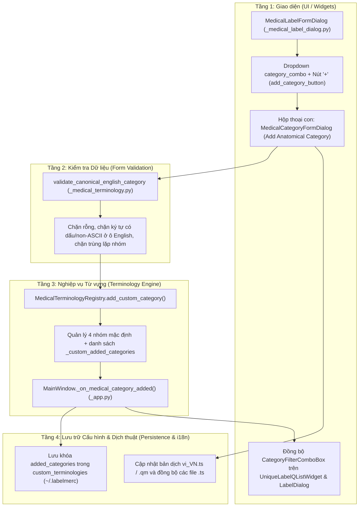

# Kế hoạch Triển khai: Hộp thoại Thêm Nhóm Giải Phẫu Y Khoa (`plan_medical_terminology_categories.md`)

## 1. Tổng quan & Nguyên tắc Cốt lõi

Nâng cấp luồng quản lý **Nhóm giải phẫu (`Anatomical Category`)** trong hộp thoại **Add Medical Label (`MedicalLabelFormDialog`)** để bác sĩ có thể trực tiếp thêm nhóm giải phẫu mới qua một hộp thoại nhỏ chuyên biệt **Add Anatomical Category (`MedicalCategoryFormDialog`)**, trong khi vẫn giữ nguyên 4 nhóm mặc định của bộ nhãn X-quang ngực (`chest_xray`).

> [!IMPORTANT]
> **Hai Nguyên tắc Bất biến của Hệ thống:**
>
> 1. **Chuẩn hóa Tiếng Anh cho AI (`Canonical English Standard`)**:
>    - Mọi định danh phục vụ AI (`canonical_label` lưu vào file `.json`, `category_id` và `en_name` của nhóm giải phẫu) bắt buộc sử dụng Tiếng Anh chuẩn (ASCII, không dấu).
> 2. **Tách bạch Chuỗi Hiển thị Bản địa hóa (`Localized UI & Display Text`)**:
>    - Toàn bộ nhãn giao diện (tiêu đề hộp thoại, nhãn trường nhập, placeholder, nút bấm, thông báo lỗi) đều đi qua hệ thống dịch thuật `tr()` / `translate()` của Qt (`.ts` / `.qm`).
>    - Mỗi Nhóm giải phẫu (`TerminologyCategory`) và Nhãn y khoa (`TerminologyItem`) đều lưu cặp tên Song ngữ: Tên chuẩn Tiếng Anh (`en_name`) và Tên hiển thị bản địa (`vi_name`) để tự động chuyển đổi theo ngôn ngữ giao diện đang bật.

______________________________________________________________________

## 2. Thiết kế Kiến trúc Xuyên 4 Tầng (4-Layer Architecture)

### Tầng 1 — Giao diện (`UI / Widgets` — \[`_medical_label_dialog.py`\](file:///home/apollai/Documents/GitHub/medical/labelme/labelme/\_widgets/\_medical_label_dialog.py))

- **Cải tiến dòng `Anatomical Category:` trên \[`MedicalLabelFormDialog`\](file:///home/apollai/Documents/GitHub/medical/labelme/labelme/\_widgets/\_medical_label_dialog.py#L183-L342)**:
  - Thay vì dùng combobox `setEditable(True)` gây hiểu lầm là chỉ có 4 nhóm cố định, chuyển `category_combo` (`_CategorySelectorComboBox`) về chế độ **Dropdown danh sách chuẩn (`setEditable(False)`)** hiển thị tên nhóm theo ngôn ngữ giao diện hiện tại (`cat.display_name(locale=...)`).
  - Cuối danh sách xổ xuống của `category_combo` có mục đặc biệt **`+ Add New Category…`** (*`+ Thêm nhóm giải phẫu mới…`*, mã sentinel `NEW_CATEGORY_SENTINEL = "__new_category__"`).
  - Đặt thêm một nút **`+` (`add_category_button`: `QToolButton`, `objectName="add_category_button"`)** nằm ngay bên phải `category_combo` trên cùng một hàng ngang (`QHBoxLayout`).
  - Khi người dùng bấm nút `+` (`add_category_button`) hoặc chọn dòng `+ Add New Category…` trong danh sách xổ xuống:
    - Mở hộp thoại nhỏ **`Add Anatomical Category` (`MedicalCategoryFormDialog`)**.
    - Nếu người dùng tạo nhóm thành công (`Accepted`): Nhóm mới được thêm ngay vào `category_combo`, tự động được chọn làm nhóm hiện tại, đồng thời kích hoạt callback đồng bộ ra bên ngoài.
    - Nếu người dùng bấm `Cancel` (`Rejected`): `category_combo` tự động khôi phục lại nhóm đang chọn trước đó.
  - Vẫn hỗ trợ phương thức `category_combo.setCurrentText(...)` để tương thích ngược 100% với các bài kiểm thử tự động hiện hữu.
- **Xây dựng Hộp thoại nhỏ `MedicalCategoryFormDialog` (`Add Anatomical Category`)**:
  - Tiêu đề cửa sổ: `Add Anatomical Category` (*`Thêm nhóm giải phẫu`*).
  - Gồm 2 trường nhập liệu rõ ràng:
    1. `Canonical English Category *:` (`english_category_edit`, `objectName="english_category_edit"`) — Bắt buộc nhập tên Tiếng Anh chuẩn (VD: `e.g. Chest wall / Bones (Canonical English)`).
    2. `Localized Display Name:` (`vietnamese_category_edit`, `objectName="vietnamese_category_edit"`) — Tùy chọn nhập tên hiển thị theo ngôn ngữ bản địa (VD: `Display name in local language (Optional)`).
  - Nhãn báo lỗi `error_label` (`objectName="error_label"`) và cụm nút `OK` (`ok_button`) / `Cancel` (`cancel_button`).

### Tầng 2 — Kiểm tra Dữ liệu (`Validation Layer` — \[`_medical_terminology.py`\](file:///home/apollai/Documents/GitHub/medical/labelme/labelme/\_medical_terminology.py))

- Bổ sung hàm kiểm tra hợp lệ `validate_canonical_english_category`:
  - Kiểm tra trường `Canonical English Category *` không được để trống.
  - Kiểm tra chỉ chứa ký tự Tiếng Anh chuẩn (printable ASCII, có ít nhất 1 chữ cái tiếng Anh). Nếu người dùng nhập tiếng Việt có dấu vào ô English, hiển thị thông báo lỗi hướng dẫn nhập tên Tiếng Anh không dấu vào ô trên và tên bản địa vào ô `Localized Display Name` ở dưới.
  - Kiểm tra chống trùng lặp (case-insensitive) với 4 nhóm mặc định và các nhóm đã có trong Preset hiện tại (so khớp cả `category_id`, `en_name` và `vi_name`).

### Tầng 3 — Nghiệp vụ & Từ vựng Y khoa (\[`_medical_terminology.py`\](file:///home/apollai/Documents/GitHub/medical/labelme/labelme/\_medical_terminology.py) & \[`_app.py`\](file:///home/apollai/Documents/GitHub/medical/labelme/labelme/\_app.py))

- Giữ nguyên **4 nhóm mặc định** của `CHEST_XRAY_CATEGORIES` (*Lung parenchyma*, *Pleura*, *Hilum / Mediastinum*, *Heart / Diaphragm / Trachea*).
- Bổ sung phương thức `MedicalTerminologyRegistry.add_custom_category(en_name, vi_name, preset_id)`:
  - Tạo đối tượng `TerminologyCategory` với `category_id = slugify_identifier(text=en_name)`, `en_name` chuẩn hóa, và `vi_name` (nếu để trống thì lấy `en_name`).
  - Thêm vào `preset.categories` và lưu vết vào `_custom_added_categories[preset.preset_id]`.
- Trên \[`MainWindow`\](file:///home/apollai/Documents/GitHub/medical/labelme/labelme/\_app.py#L4492-L4516), bổ sung callback `_on_medical_category_added` để ngay khi bác sĩ thêm nhóm mới từ `MedicalCategoryFormDialog`, hệ thống tự động lưu vào `~/.labelmerc` và làm mới danh sách nhóm trên `UniqueLabelQListWidget` cũng như `LabelDialog`.

### Tầng 4 — Lưu trữ Cấu hình & Đa ngôn ngữ (`Persistence & i18n`)

- **Lưu trữ bền vững (`to_custom_config` & `load_custom_config`)**:
  - Mở rộng cấu trúc `custom_terminologies` trong `~/.labelmerc` để lưu thêm khóa `added_categories` theo từng `preset_id`. Nhờ đó, ngay cả khi bác sĩ mới chỉ tạo nhóm giải phẫu mà chưa thêm nhãn hoặc đóng ứng dụng mở lại, nhóm giải phẫu mới vẫn được bảo toàn đầy đủ cả tên Tiếng Anh lẫn tên Tiếng Việt.
- **Biên dịch Đa ngôn ngữ (\[`vi_VN.ts`\](file:///home/apollai/Documents/GitHub/medical/labelme/labelme/translate/vi_VN.ts) & `.qm`)**:
  - Bổ sung context `MedicalCategoryFormDialog` và các chuỗi dịch mới trong `MedicalLabelFormDialog` vào toàn bộ các file `.ts` và biên dịch lại `vi_VN.qm`, đảm bảo `just check_translate` và `just lint` đạt 100%.
