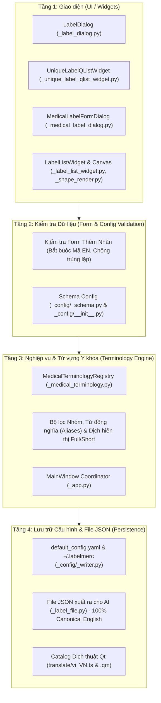

# Kế hoạch Triển khai: Hệ thống Bộ Từ vựng Y khoa & Chọn Nhãn kiểu 3D Slicer (`plan_medical_terminology_labels.md`)

## 1. Tổng quan Kiến trúc & Nguyên tắc Cốt lõi

Nâng cấp hệ thống quản lý nhãn của **Labelme** theo mô hình **Terminology Navigator của 3D Slicer**, phục vụ trực tiếp quy trình gán nhãn hình ảnh y khoa (X-quang, CT, MRI...) cho bác sĩ và xuất dữ liệu chuẩn hóa cho huấn luyện AI.

> [!IMPORTANT]
> **5 Nguyên tắc Kiến trúc Đã Chốt:**
>
> 1. **Chuẩn hóa Lưu trữ JSON cho AI (`Canonical English ID`)**: Mọi nhãn lưu trong file `.json` (`shapes[*].label`) luôn là chuỗi Tiếng Anh chuẩn xác, đầy đủ về mặt giải phẫu (VD: `"Lung opacity"`, `"Pulmonary nodule"`, `"Pleural calcification"`).
> 2. **Hiển thị Đa ngôn ngữ theo UI (`Locale-Aware Display`)**:
>    - Khi phần mềm chạy ngôn ngữ Tiếng Việt (`vi_VN`), giao diện hiển thị tên Tiếng Việt.
>    - Khi chạy Tiếng Anh (`en_US`) hoặc ngôn ngữ khác, giao diện hiển thị tên Tiếng Anh.
> 3. **Hiển thị Rút gọn theo Ngữ cảnh Nhóm (`Context-Aware Short Display`)**:
>    - Khi bác sĩ đang chọn chế độ **"Tất cả (All)"**, hoặc nhìn trên **Shape List / Canvas**: Hiển thị **Tên đầy đủ** (`Lung opacity` / `Đám mờ phổi`, `Pleural calcification` / `Vôi hóa màng phổi`) để không bao giờ bị nhầm lẫn giữa các nhóm giải phẫu.
>    - Khi bác sĩ đã bấm lọc vào **1 Nhóm cụ thể** (VD: đang đứng trong nhóm *Nhu mô phổi / Lung parenchyma*): Hiển thị **Tên rút gọn** (`Opacity` / `Đám mờ`, `Nodule` / `Nốt`, `Mass` / `Khối`...) giúp bác sĩ quét mắt và chọn nhãn trong tích tắc.
> 4. **Khởi động Mặc định với Bộ 21 Nhãn X-quang Ngực (`Chest X-Ray Preset`)**: Ngay khi mở phần mềm, bộ 21 nhãn X-quang phổi (chia làm 4 nhóm giải phẫu kèm bảng màu y khoa cố định) được kích hoạt sẵn.
> 5. **Bổ sung Nhãn & Chuyển đổi Bộ nhãn 100% qua Form UI (Không nạp từ file ngoài)**: Bác sĩ thêm nhãn mới hoặc tạo/chuyển đổi Bộ nhãn (Preset) thông qua hộp thoại Form UI có kiểm tra hợp lệ (bắt buộc nhập mã chuẩn Tiếng Anh cho AI), loại bỏ hoàn toàn rủi ro lỗi định dạng file.

______________________________________________________________________

## 2. Định vị Kiến trúc 4 Tầng (4-Layer Architecture Mapping)

### Tầng 1 — Giao diện (`UI / Widgets`)

- **\[`labelme/_widgets/_label_dialog.py`\](file:///home/apollai/Documents/GitHub/medical/labelme/labelme/\_widgets/\_label_dialog.py) (`LabelDialog`)**:
  - Bổ sung thanh công cụ tinh gọn gồm **1 ô Dropdown Lọc Nhóm giải phẫu (`category_combo`: `QComboBox`, `stretch=1`)** và **1 nút `+` (`add_label_button`: `QToolButton`)** ở phía trên (không có ô chọn Preset gây rối mắt).
  - Ô **Lọc Nhóm giải phẫu (`category_combo`)** gồm `"Tất cả"` (`"All"`) và 4 nhóm giải phẫu chuẩn (*Nhu mô phổi*, *Màng phổi*, *Rốn phổi / trung thất*, *Tim / cơ hoành / khí quản*, cùng các nhóm mới nếu bác sĩ tự thêm).
  - Nâng cấp danh sách `label_list`:
    - Hiển thị ô màu đặc trưng (`LABEL_COLOR_ROLE` với `ColorSwatchDelegate`).
    - Khi chọn `"Tất cả"`: Hiển thị tên đầy đủ theo ngôn ngữ UI.
    - Khi chọn 1 Nhóm cụ thể: Chỉ hiển thị các nhãn thuộc nhóm đó với **tên rút gọn (`short_name`)**.
    - Khi bác sĩ gõ vào ô `edit`: Tự động lọc trực tiếp các dòng trong `label_list` theo cả tên Tiếng Anh, Tiếng Việt, tên rút gọn và từ đồng nghĩa (ví dụ gõ `"opacity"`, `"collapse"`, `"deviation"`, `"đám mờ"`, `"nốt"` đều khớp).
    - Lưu mã chuẩn Tiếng Anh (`canonical_label`) trong `Qt.ItemDataRole.UserRole` của từng item; khi bác sĩ chọn hoặc double-click một item, hộp thoại luôn trả về `LabelDialogEntry.label` là **mã chuẩn Tiếng Anh**.
- **\[`labelme/_widgets/_unique_label_qlist_widget.py`\](file:///home/apollai/Documents/GitHub/medical/labelme/labelme/\_widgets/\_unique_label_qlist_widget.py) (`UniqueLabelQListWidget` - Bảng Label List bên phải)**:
  - Trên phần đầu của bảng `Label List`, tích hợp thanh công cụ tinh gọn chỉ gồm 2 phần tử:
    - **1 ô Dropdown Lọc Nhóm (`category_combo`, `stretch=1`)**: Lọc nhanh theo nhóm giải phẫu ngay trên bảng bên phải (khi lọc theo nhóm hiển thị tên rút gọn, khi để `"Tất cả"` hiển thị tên đầy đủ).
    - **1 nút `+` (`add_label_button`)**: Mở Form UI (`MedicalLabelFormDialog`) để bác sĩ tự bổ sung nhãn mới vào nhóm đã chọn hoặc nhóm mới.
  - Mỗi dòng nhãn giữ mã chuẩn Tiếng Anh trong `Qt.ItemDataRole.UserRole` và hiển thị chuỗi đã dịch theo ngôn ngữ UI (`DisplayRole`).
- **File mới `labelme/_widgets/_medical_label_dialog.py` (`MedicalLabelFormDialog`)**:
  - Form UI chuyên dụng để bác sĩ **Thêm nhãn mới** với các trường:
    - `english_label_edit` (*Tên chuẩn Tiếng Anh lưu JSON - Bắt buộc*)
    - `vietnamese_label_edit` (*Tên hiển thị Tiếng Việt - Tùy chọn*)
    - `short_english_edit` / `short_vietnamese_edit` (*Tên rút gọn khi lọc trong Nhóm - Tùy chọn*)
    - `category_combo` (*Chọn Nhóm có sẵn hoặc nhập Nhóm mới*)
    - `color_button` (*Chọn màu hiển thị cho nhãn, tự động gợi ý màu chưa trùng*)
- **\[`labelme/_widgets/_label_list_widget.py`\](file:///home/apollai/Documents/GitHub/medical/labelme/labelme/\_widgets/\_label_list_widget.py) & \[`labelme/_widgets/_shape_render.py`\](file:///home/apollai/Documents/GitHub/medical/labelme/labelme/\_widgets/\_shape_render.py)**:
  - Hàm `format_shape_label` và bộ vẽ nhãn trên Canvas tra cứu qua `MedicalTerminologyRegistry` để hiển thị tên đầy đủ theo ngôn ngữ UI (Tiếng Việt hoặc Tiếng Anh), trong khi `shape.label` bên dưới vẫn giữ nguyên mã chuẩn Tiếng Anh.

### Tầng 2 — Kiểm tra Dữ liệu (`Validation Layer`)

- **Validation trên `MedicalLabelFormDialog`**:
  - Trường *Tên chuẩn Tiếng Anh* không được để trống, tự động cắt khoảng trắng thừa hai đầu (`strip()`), không được chứa ký tự điều khiển, và không được trùng (case-insensitive) với mã chuẩn đã có trong bộ nhãn.
  - Nếu bác sĩ gõ ký tự có dấu tiếng Việt vào ô *Tên chuẩn Tiếng Anh*, Form sẽ cảnh báo rõ ràng và hướng dẫn nhập từ tiếng Anh không dấu vào ô chuẩn AI, còn tên tiếng Việt nhập vào ô Tiếng Việt bên dưới.
- **Validation trên Cấu hình (`labelme/_config/__init__.py`)**:
  - Hỗ trợ khóa cấu hình `label_preset` (tên bộ nhãn đang kích hoạt, mặc định `"chest_xray"`) và `custom_terminologies` (lưu các nhãn hoặc bộ nhãn do bác sĩ tự thêm qua Form UI vào `~/.labelmerc`) mà vẫn tương thích ngược 100% với các bài test `labels` truyền thống của Labelme.

### Tầng 3 — Nghiệp vụ & Từ vựng Y khoa (`labelme/_medical_terminology.py`)

- Thiết kế module trung tâm `_medical_terminology.py` quản lý:
  - Cấu trúc `TerminologyItem`:
    - `canonical_label`: Mã chuẩn Tiếng Anh lưu vào JSON (VD: `"Lung opacity"`).
    - `en_full`, `en_short`: Tên Tiếng Anh đầy đủ và rút gọn trong nhóm.
    - `vi_full`, `vi_short`: Tên Tiếng Việt đầy đủ và rút gọn trong nhóm.
    - `category_id`, `category_en`, `category_vi`: Định danh và tên nhóm song ngữ.
    - `color`: Bộ 3 số RGB `(r, g, b)` cố định theo chuẩn y khoa.
    - `aliases`: Danh sách từ khóa đồng nghĩa để tìm kiếm nhanh (VD: `("opacity", "lung opacity", "đám mờ phổi", "dam mo phoi")`).
  - Cấu trúc `TerminologyPreset`: Quản lý bộ nhãn mặc định `chest_xray` (21 nhãn, 4 nhóm) và các bộ nhãn tùy chỉnh của bác sĩ.
  - Hàm tra cứu hiển thị `get_display_label(canonical_label, locale, category_filter_active)`:
    - Trả về tên hiển thị phù hợp với ngôn ngữ hiện tại và trạng thái lọc nhóm (đầy đủ khi xem Tất cả, rút gọn khi đang lọc 1 Nhóm).
  - Hàm phân giải ngược `resolve_canonical_label(input_text)`:
    - Nếu bác sĩ gõ tên Tiếng Việt (VD: `"Đám mờ phổi"`), tên rút gọn (`"Opacity"`), hay chọn từ danh sách, hàm đều phân giải chính xác về `"Lung opacity"` để lưu vào `Shape.label` và file JSON.

### Tầng 4 — Dữ liệu, Cấu hình & Đa ngôn ngữ (`Persistence & i18n`)

- **\[`labelme/_config/default_config.yaml`\](file:///home/apollai/Documents/GitHub/medical/labelme/labelme/\_config/default_config.yaml)**:
  - Giữ tương thích với các bài kiểm thử schema hiện hữu và bổ sung cấu hình bộ nhãn y khoa mặc định.
- **\[`labelme/translate/vi_VN.ts`\](file:///home/apollai/Documents/GitHub/medical/labelme/labelme/translate/vi_VN.ts)** (và các file `.ts`/`.qm` qua `just update_translate`):
  - Cập nhật đầy đủ bản dịch Tiếng Việt cho tất cả các chuỗi giao diện mới (Bộ nhãn, Nhóm bệnh lý, Tất cả nhóm, Thêm nhãn mới, Tạo bộ nhãn...) và biên dịch ra file `.qm`.

______________________________________________________________________

## 3. Bảng Tham chiếu Chuẩn 21 Nhãn X-quang Ngực (`chest_xray`)

| STT | `canonical_label` (Lưu JSON & EN Full) | `en_short` (Khi lọc Nhóm) | `vi_full` (VI khi xem Tất cả) | `vi_short` (VI khi lọc Nhóm) | Nhóm (`category_vi` / `category_en`) | Từ khóa tìm kiếm (`aliases`) | Màu RGB |
| :-: | :--- | :--- | :--- | :--- | :--- | :--- | :--- |
| 1 | `Lung opacity` | `Opacity` | Đám mờ phổi | Đám mờ | Nhu mô phổi / *Lung parenchyma* | `opacity`, `lung opacity`, `đám mờ` | `[255, 165, 0]` |
| 2 | `Consolidation` | `Consolidation` | Đông đặc phổi | Đông đặc | Nhu mô phổi / *Lung parenchyma* | `consolidation`, `đông đặc` | `[255, 140, 0]` |
| 3 | `Pulmonary nodule` | `Nodule` | Nốt phổi | Nốt | Nhu mô phổi / *Lung parenchyma* | `nodule`, `pulmonary nodule`, `nốt` | `[255, 69, 58]` |
| 4 | `Pulmonary mass` | `Mass` | Khối phổi | Khối | Nhu mô phổi / *Lung parenchyma* | `mass`, `pulmonary mass`, `khối`, `u phổi` | `[220, 20, 60]` |
| 5 | `Cavity` | `Cavity` | Hang phổi | Hang | Nhu mô phổi / *Lung parenchyma* | `cavity`, `cavitation`, `hang` | `[255, 99, 71]` |
| 6 | `Pulmonary fibrosis` | `Fibrosis` | Xơ hóa phổi | Xơ hóa | Nhu mô phổi / *Lung parenchyma* | `fibrosis`, `pulmonary fibrosis`, `xơ hóa`, `xơ phổi` | `[218, 165, 32]` |
| 7 | `Calcification` | `Calcification` | Vôi hóa | Vôi hóa | Nhu mô phổi / *Lung parenchyma* | `calcification`, `vôi hóa` | `[240, 230, 140]` |
| 8 | `Interstitial opacity` | `Interstitial opacity` | Tổn thương dạng kẽ | Tổn thương dạng kẽ | Nhu mô phổi / *Lung parenchyma* | `interstitial pattern`, `interstitial opacity`, `dạng kẽ` | `[255, 215, 0]` |
| 9 | `Atelectasis` | `Atelectasis` | Xẹp phổi | Xẹp | Nhu mô phổi / *Lung parenchyma* | `atelectasis`, `lung collapse`, `collapse`, `xẹp` | `[205, 92, 92]` |
| 10 | `Emphysema` | `Emphysema` | Khí phế thũng | Khí phế thũng | Nhu mô phổi / *Lung parenchyma* | `emphysema`, `khí phế thũng` | `[255, 182, 193]` |
| 11 | `Bronchiectasis` | `Bronchiectasis` | Giãn phế quản | Giãn phế quản | Nhu mô phổi / *Lung parenchyma* | `bronchiectasis`, `giãn phế quản` | `[255, 105, 180]` |
| 12 | `Pleural effusion` | `Effusion` | Tràn dịch màng phổi | Tràn dịch | Màng phổi / *Pleura* | `effusion`, `pleural effusion`, `tràn dịch` | `[30, 144, 255]` |
| 13 | `Pleural thickening` | `Thickening` | Dày màng phổi | Dày | Màng phổi / *Pleura* | `thickening`, `pleural thickening`, `dày màng phổi` | `[0, 191, 255]` |
| 14 | `Pneumothorax` | `Pneumothorax` | Tràn khí màng phổi | Tràn khí | Màng phổi / *Pleura* | `pneumothorax`, `tràn khí` | `[0, 255, 255]` |
| 15 | `Blunted costophrenic angle` | `Blunted costophrenic angle` | Tù góc sườn hoành | Tù góc sườn hoành | Màng phổi / *Pleura* | `blunted costophrenic angle`, `góc sườn hoành` | `[100, 149, 237]` |
| 16 | `Pleural calcification` | `Calcification` | Vôi hóa màng phổi | Vôi hóa | Màng phổi / *Pleura* | `pleural calcification`, `vôi hóa màng phổi` | `[135, 206, 250]` |
| 17 | `Hilar enlargement` | `Hilar enlargement` | Rốn phổi to | Rốn phổi to | Rốn phổi / trung thất / *Hilum / Mediastinum* | `hilar enlargement`, `rốn phổi to` | `[50, 205, 50]` |
| 18 | `Hilar or mediastinal lymphadenopathy` | `Lymphadenopathy` | Hạch rốn phổi hoặc trung thất to | Hạch to | Rốn phổi / trung thất / *Hilum / Mediastinum* | `lymphadenopathy`, `hạch rốn phổi`, `hạch trung thất` | `[0, 250, 154]` |
| 19 | `Mediastinal widening` | `Mediastinal widening` | Trung thất rộng | Trung thất rộng | Rốn phổi / trung thất / *Hilum / Mediastinum* | `mediastinal widening`, `trung thất rộng` | `[124, 252, 0]` |
| 20 | `Cardiomegaly` | `Cardiomegaly` | Tim to | Tim to | Tim / cơ hoành / khí quản / *Heart / Diaphragm / Trachea* | `cardiomegaly`, `tim to`, `bóng tim to` | `[186, 85, 211]` |
| 21 | `Tracheal shift` | `Tracheal shift` | Di lệch khí quản | Di lệch khí quản | Tim / cơ hoành / khí quản / *Heart / Diaphragm / Trachea* | `tracheal shift`, `tracheal deviation`, `deviation`, `di lệch khí quản` | `[147, 112, 219]` |

______________________________________________________________________

## 4. Tương thích Ngược & Kiểm thử Toàn diện

- **Tương thích hoàn toàn với Test Suite hiện hữu**:
  - Khi `LabelDialog` hoặc `UniqueLabelQListWidget` được khởi tạo trong các bài test đơn vị cũ với danh sách `labels=["cat", "dog"]` (không dùng preset y khoa), mọi hành vi, thứ tự tab focus (`edit` $\\rightarrow$ `edit_group_id`), phím mũi tên lên/xuống và `QCompleter` đều hoạt động nguyên vẹn 100%.
  - Khi chạy ứng dụng thực tế hoặc bật preset `chest_xray`, toàn bộ tính năng phân nhóm 3D Slicer, hiển thị theo ngôn ngữ UI, rút gọn theo nhóm và Form thêm nhãn y khoa sẽ hoạt động đầy đủ.
- **Tất cả Câu hỏi Mở đã được giải quyết 100%** (Không còn câu hỏi mở).
